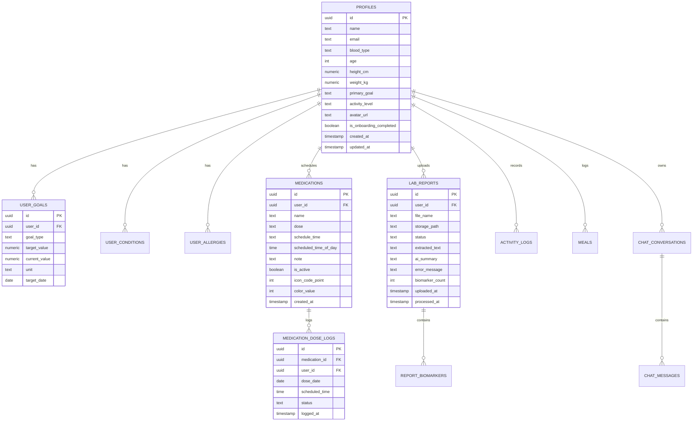

# Zindagi+ (زندگی+)

[](https://flutter.dev)
[](https://dart.dev)
[](https://supabase.com)
[](https://developers.google.com/ml-kit)
[](file:///test)
[](file:///lib)

**Zindagi+** is a production-ready personal health management Flutter mobile application designed for secure health tracking, medication scheduling, and laboratory diagnostic report processing. It combines **100% on-device Google ML Kit Optical Character Recognition (OCR)**, **spatial 2D layout reconstruction**, a deterministic **30-minute grace-period medication state machine**, and **Supabase authentication & database infrastructure**.

---

# Table of Contents

1. [Project Overview](#project-overview)
2. [Implementation Status Matrix](#implementation-status-matrix)
3. [Architecture & Technology Stack](#architecture--technology-stack)
4. [Authentication Architecture](#authentication-architecture)
5. [State Management & Routing](#state-management--routing)
6. [Lab Report System & Google ML Kit OCR](#lab-report-system--google-ml-kit-ocr)
7. [2D Spatial Layout Reconstruction](#2d-spatial-layout-reconstruction)
8. [Lab Report Data Models](#lab-report-data-models)
9. [Medication Management & Grace Period Engine](#medication-management--grace-period-engine)
10. [Database Architecture & Schema](#database-architecture--schema)
11. [Testing & Quality Assurance](#testing--quality-assurance)
12. [Project Setup & Configuration](#project-setup--configuration)

---

# Project Overview

Managing medications, understanding laboratory test reports, and tracking vital metrics is often fragmented and complex for patients. **Zindagi+** addresses these challenges by providing:

* **On-Device Lab Report Digitization**: Extracts and structures tabular data (e.g. Complete Blood Count, Lipid Profile, Renal Function Tests) directly from scanned lab reports using Google ML Kit on-device text recognition with zero external vision cloud API dependencies.
* **Deterministic Medication Adherence**: Provides scheduled reminders, multiple daily dose isolation, and a robust 30-minute grace period boundary state machine (`Pending` $\rightarrow$ `Taken` $\rightarrow$ `Undo` / `Missed` $\rightarrow$ `Taken`) with background reconciliation.
* **Secure Health Profile & Goal Tracking**: Manages demographics, health metrics, conditions, allergies, and lifestyle goals backed by Supabase PostgreSQL and Row-Level Security (RLS).

---

# Implementation Status Matrix

| Component | Status | Details |
| :--- | :---: | :--- |
| **Email/Password Auth & Verification** |  **Implemented** | Signup, login, email verification, OTP verification, password reset. |
| **Google Sign-In (OAuth)** |  **Implemented** | Supabase browser-based OAuth with custom tabs and deep link callback. |
| **Auth Session Guards & Routing** |  **Implemented** | `GoRouter` redirect guards for unauthenticated, un-onboarded, and onboarded users. |
| **Onboarding & Profile Setup** |  **Implemented** | Multi-step setup, health goals upsert with conflict handling, demographic metrics. |
| **Profile Photo Upload** |  **Implemented** | Supabase Storage `avatars` bucket with public/authenticated sync. |
| **Medication Scheduling & Tracking** |  **Implemented** | Active medication list, soft deletion, multiple daily doses isolation. |
| **30-Min Grace Period State Machine** |  **Implemented** | Deterministic transition: `Pending` $\rightarrow$ `Taken` $\rightarrow$ `Undo` / `Missed` $\rightarrow$ `Taken`. |
| **Missed Dose Reconciliation** |  **Implemented** | Background check and app-resume auto-reconciliation of past-due doses. |
| **Local Medication Notifications** |  **Implemented** | `flutter_local_notifications` with exact alarms, boot receivers, and tap-to-navigate. |
| **Real On-Device ML Kit OCR** |  **Implemented** | Google ML Kit on-device text recognition on Android & iOS (zero cloud API calls). |
| **2D Spatial Layout Reconstructor** |  **Implemented** | Bounding box clustering, left-to-right sorting, and section grouping. |
| **Structured Lab Results Presentation** |  **Implemented** | Multi-column table rendering with expandable uninterpreted raw OCR card. |
| **Report Storage & Fallback** |  **Implemented** | Supabase Storage `reports` bucket upload and missing local cache fallback. |
| **Health Score Breakdown** | 🟡 *UI Mock* | UI representation of health scores; full algorithmic scoring is planned. |
| **Meals & Nutrition Logging** | 🟡 *UI Mock* | Mock meal entries and nutritional breakdowns. |
| **AI Health Assistant Chat** | 🟡 *UI Mock* | Interactive conversational UI with localized assistant responses. |
| **Nearby Healthcare Facilities** | 🟡 *UI Mock* | Facility list with categories and emergency dialer integration. |
| **Clinical AI Interpretation** | ⚪ *Planned* | LLM-based biomarker summary and clinical trend analysis. |

---

# Architecture & Technology Stack

The application follows a clean layered architecture with dependency inversion:

```
┌─────────────────────────────────────────────────────────────┐
│                    Flutter Presentation                     │
│    (Screens, Widgets, Material 3 UI, GoRouter Navigation)   │
└──────────────────────────────┬──────────────────────────────┘
                               │ Watches / Reads
┌──────────────────────────────▼──────────────────────────────┐
│                  Riverpod State Management                  │
│    (AuthNotifier, MedicationNotifier, ReportNotifier, etc.)  │
└──────────────────────────────┬──────────────────────────────┘
                               │ Calls
┌──────────────────────────────▼──────────────────────────────┐
│                    Repository Interfaces                    │
│   (AuthRepository, MedicationRepository, LabReportRepo)     │
└──────────────────────────────┬──────────────────────────────┘
                               │ Implements
       ┌───────────────────────┴───────────────────────┐
       ▼                                               ▼
┌──────────────────────────────┐       ┌──────────────────────────────┐
│    Supabase Implementations  │       │     Local Device Services    │
│  - AuthRepositorySupabase    │       │  - MlKitOcrService           │
│  - MedicationRepoSupabase    │       │  - OcrLayoutReconstructor    │
│  - LabReportRepoSupabase     │       │  - NotificationService       │
└──────────────┬───────────────┘       └──────────────┬───────────────┘
               │                                      │
               ▼                                      ▼
┌──────────────────────────────┐       ┌──────────────────────────────┐
│    Supabase Cloud Backend    │       │     Android / iOS Runtime    │
│  - PostgreSQL with RLS       │       │  - Google Play Services      │
│  - GoTrue Authentication     │       │  - flutter_local_notifs      │
│  - Private Storage Buckets   │       │  - Exact Alarm Managers      │
└──────────────────────────────┘       └──────────────────────────────┘
```

### Core Technologies:
* **Flutter SDK**: `^3.12.2` (Dart 3.x)
* **State Management**: `flutter_riverpod: ^2.6.1`
* **Navigation**: `go_router: ^15.1.2`
* **Backend & Auth**: `supabase_flutter: ^2.17.1`
* **OCR Engine**: `google_mlkit_text_recognition: ^0.17.1`
* **Local Notifications**: `flutter_local_notifications: ^18.0.1` & `timezone: ^0.10.0`
* **Media & File Picker**: `image_picker: ^1.1.2`
* **Networking**: `dio: ^5.8.0+1`

---

# Authentication

Zindagi+ implements a multi-provider authentication system powered by **Supabase Auth (GoTrue)** with session persistence and reactive routing.

```
                      ┌────────────────────────────┐
                      │    Login / Signup Screen   │
                      └──────┬──────────────┬──────┘
                             │              │
             Email / Password│              │Google OAuth
                             ▼              ▼
           ┌──────────────────────┐  ┌───────────────────────────────────┐
           │ Supabase Auth Client │  │ Browser Custom Tab (OAuth 2.0)   │
           └──────────┬───────────┘  └─────────────────┬─────────────────┘
                      │                                │ Deep Link Callback
                      │                                ▼
                      │              ┌───────────────────────────────────┐
                      │              │ io.supabase.zindagiplus://        │
                      │              │ login-callback/                   │
                      │              └─────────────────┬─────────────────┘
                      │                                │
                      ▼                                ▼
           ┌─────────────────────────────────────────────────────────────┐
           │               Supabase Session Established                  │
           └──────────────────────────────┬──────────────────────────────┘
                                          │ AuthState Changes
                                          ▼
           ┌─────────────────────────────────────────────────────────────┐
           │          AuthNotifier (Restores User Profile & Goals)        │
           └──────────────────────────────┬──────────────────────────────┘
                                          │ Updates State
                                          ▼
           ┌─────────────────────────────────────────────────────────────┐
           │      GoRouter Redirect Guards (/onboarding or /dashboard)   │
           └─────────────────────────────────────────────────────────────┘
```

### Features Supported:
1. **Email & Password**: Registration (`register`), Login (`login`), Email Confirmation, OTP verification (`verifyOtp`), Resend confirmation email (`resendVerificationEmail`).
2. **Password Recovery**: Forgot password email dispatch (`resetPasswordForEmail`) and in-app password update (`updatePassword`).
3. **Google Sign-In (Approach B - Browser OAuth)**:
   - Uses `supabase.auth.signInWithOAuth(OAuthProvider.google, redirectTo: Environment.authCallbackUrl)`.
   - Android handles the deep link callback via `AndroidManifest.xml` intent-filter:
     - Scheme: `io.supabase.zindagiplus`
     - Host: `login-callback`
   - Client secrets are never embedded in the mobile binary.
4. **Session Lifecycle & Guarding**:
   - `AuthNotifier` subscribes to `_authRepo.authStateChanges`.
   - Upon sign-in or token refresh, `restoreSession()` fetches the user's profile and goal metadata.
   - `_RouterNotifier` re-evaluates `GoRouter` navigation rules dynamically on every auth transition.
5. **Account Deletion**: Complete user data purging via `AuthRepository.deleteAccount()`.

---

# State Management & Routing

### Riverpod Providers (`lib/providers/`)
* `authNotifierProvider`: Global state notifier holding the active `User?` object.
* `medicationProvider`: Manages active medications, adherence calculation, and dose transitions.
* `reportProcessingProvider`: Coordinates file upload, progress feedback, and OCR execution.
* `reportDetailProvider(id)`: Fetches a single lab report by ID from Supabase.
* `reportHistoryProvider`: Streams/fetches all uploaded reports for the authenticated user.
* `ocrServiceProvider`: Instantiates `MlKitOcrService` on Android/iOS and `MockOcrService` on host test environments.

### Route Overview (`lib/routes/app_router.dart`)

```
/splash ──────────────────────────► Initial route & session restoration
  │
  ├──► /login ────────────────────► Email & password login + Google OAuth
  ├──► /register ─────────────────► Account creation
  ├──► /email-verification ──────► Confirmation & OTP verification
  ├──► /forgot-password ──────────► Request password recovery link
  ├──► /reset-password ───────────► Set new password
  │
  ├──► /onboarding/setup ─────────► Questionnaire & profile initialization
  │
  └──► /dashboard (AppShell) ────► Bottom Navigation Shell
        │
        ├── Tab 0: /dashboard ────► Health Score, Quick Actions, Daily Medications
        │     ├── /score-breakdown
        │     ├── /weekly-review
        │     └── /activities
        │
        ├── Tab 1: /upload ───────► Scan/upload medical lab report
        │     ├── /upload/processing
        │     ├── /upload/result ─► Structured Report Tables & Raw OCR
        │     └── /upload/explanation
        │
        ├── Tab 2: /meals ────────► Nutrition logging & Meal details
        │     └── /meals/:id
        │
        ├── Tab 3: /chat ─────────► AI Health Assistant
        │
        └── Tab 4: /profile ──────► Profile summary & metrics
              ├── /profile/edit ──► Demographics, Goals, Allergies
              └── /settings ──────► Notifications, Account, Privacy Policy
```

---

# Lab Report System & Google ML Kit OCR

The lab report pipeline takes an uploaded medical document, stores the raw image in private Supabase Storage, and extracts the text on-device.

```
  ┌──────────────┐
  │ User Selects │
  │ Report Image │
  └──────┬───────┘
         │
         ▼
  ┌────────────────────────────────────────────────────────┐
  │ UploadScreen (ImagePicker: Gallery or Camera)          │
  └──────┬─────────────────────────────────────────────────┘
         │
         ▼
  ┌────────────────────────────────────────────────────────┐
  │ ReportProcessingScreen (ReportProcessingNotifier)       │
  └──────┬─────────────────────────────────────────────────┘
         │
         ├──► 1. Upload original image to Supabase Storage ('reports' bucket)
         │       Path: {user_id}/{timestamp}_{filename}
         │       Inserts initial row in 'public.lab_reports' (status: 'uploaded')
         │
         ├──► 2. Execute On-Device Google ML Kit Text Recognition
         │       (Runs locally via MlKitOcrService on Android/iOS)
         │
         ├──► 3. Spatial 2D Layout Reconstruction
         │       (Clusters bounding boxes into visual rows, left-to-right)
         │
         ├──► 4. Save EXACT raw OCR text to 'public.lab_reports.extracted_text'
         │       (Updates status: 'completed')
         │
         ▼
  ┌────────────────────────────────────────────────────────┐
  │ ReportDetailScreen                                     │
  │ - Structured Lab Result Tables (Sections & Rows)       │
  │ - Uninterpreted Raw OCR Text Container (Expandable)    │
  └────────────────────────────────────────────────────────┘
```

### Key Principles of the OCR Engine:
1. **100% On-Device**: Uses `google_mlkit_text_recognition`. Scanned documents are processed locally without third-party cloud vision dependencies.
2. **Strict Zero-Mock Policy**: Real mobile devices **never** substitute sample reports or hardcoded medical values.
3. **Storage Fallback**: If the local file cache is deleted or cleared during processing, the repository automatically streams the original image from the private Supabase Storage `reports` bucket.
4. **Failure Preservation**: If OCR cannot recognize legible text or the document is unreadable, the report transitions to `status: 'failed'` with an explicit diagnostic message and preserves the record for user retry.

---

# 2D Spatial Layout Reconstruction

Standard OCR engines flatten multi-column documents into vertical blocks, separating parameter names from their measurement values and reference intervals. 

`OcrLayoutReconstructor` ([lib/services/ocr/ocr_layout_reconstructor.dart](file:///c:/Users/hp/Desktop/Zindagi+/lib/services/ocr/ocr_layout_reconstructor.dart)) solves this by analyzing the 2D bounding boxes of all `TextLine` elements:

```
Visual Scan Layout:
Haemoglobin [Y: 200, X: 50]    13.8 [Y: 201, X: 250]    g/dL [Y: 200, X: 350]    13.0 - 17.0 [Y: 202, X: 450]
WBC         [Y: 230, X: 50]    7200 [Y: 231, X: 250]    /uL  [Y: 230, X: 350]    4000 - 11000 [Y: 230, X: 450]

                             │
                             ▼ Adaptive Vertical Clustering (Median Line Height)
                             │
Reconstructed Visual Rows:
Row 1: Haemoglobin    13.8    g/dL    13.0 - 17.0
Row 2: WBC    7200    /uL    4000 - 11000
```

### Parsing Rules & Guarantees:
* **Section Detection**: Automatically detects known diagnostic headers (e.g. `COMPLETE BLOOD COUNT`, `LIPID PROFILE`, `RENAL FUNCTION TESTS`, `LIVER FUNCTION TESTS`) and groups rows under them.
* **Never Invent Data**: If a test line does not have a reference range or unit, the fields remain `null` and render as `—`. The system **never** guesses or fabricates values.
* **No Medical Interpretation**: The parser does not classify values as "High", "Low", "Normal", or "Abnormal". It strictly formats what was printed.
* **Unclassified Data Retention**: Header text, patient details, and doctor notes are preserved in an expandable **Additional Document Notes** section.

---

# Lab Report Data Models

### 1. `LabReport` (`lib/data/models/lab_report.dart`)
* `id` (`String`): UUID primary key.
* `userId` (`String?`): Supabase `auth.uid()` of the document owner.
* `fileName` (`String`): Original file name uploaded.
* `storagePath` (`String`): Storage bucket path (`reports/{userId}/{file}`).
* `status` (`ReportStatus`): `uploaded`, `processing`, `completed`, or `failed`.
* `extractedText` (`String`): Complete, uninterpreted raw OCR text string.
* `errorMessage` (`String?`): Diagnostic failure details if processing failed.
* `uploadedAt` (`DateTime`): Timestamp of initial upload.
* `processedAt` (`DateTime?`): Timestamp of OCR completion.

### 2. Structured Layout Models (`lib/data/models/structured_lab_report.dart`)
* `LabResultRow`:
  - `parameterName` (`String`): Extracted parameter name (e.g., "Haemoglobin").
  - `result` (`String`): Measured result value (e.g., "13.8", "Positive").
  - `unit` (`String?`): Measurement unit if present (e.g., "g/dL"), or `null`.
  - `referenceRange` (`String?`): Normal reference interval if present (e.g., "13.0 - 17.0"), or `null`.
  - `originalText` (`String`): Unmodified source text line.
* `LabReportSection`:
  - `title` (`String`): Section title (e.g., "Complete Blood Count").
  - `rows` (`List<LabResultRow>`): All test rows belonging to this section.
* `StructuredLabReport`:
  - `sections` (`List<LabReportSection>`): All identified clinical sections.
  - `unclassifiedLines` (`List<String>`): Non-tabular metadata (patient name, dates, notes).
  - `rawText` (`String`): Exact raw OCR text.

---

# Medication Management & Grace Period Engine

Zindagi+ features an adherence tracking system with a **deterministic 30-minute grace-period boundary state machine**.

```
Scheduled Time: 08:00 AM
─────────────────────────────────────────────────────────────────────────────► Time
       08:00 AM                       08:30 AM
          │                              │
          ▼                              ▼
    [ SCHEDULED ] ─── 30-Min Grace ────► [ MISSED ]
          │          (PENDING)           │
          │ Actionable                   │ Actionable (Late)
          ▼                              ▼
    User Taps Dose                 User Taps Dose
          │                              │
          ▼                              ▼
    [   TAKEN   ] ◄──────────────────────┘
          │
          │ User Taps Again (Undo)
          ▼
    [ PENDING / RESTORED ]
```

### Deterministic Rules:
1. **Grace Period Boundary**:
   - Time $< (\text{Scheduled Time} + \text{30 minutes})$ $\longrightarrow$ `PENDING` (Actionable).
   - Time $\ge (\text{Scheduled Time} + \text{30 minutes})$ with no dose log $\longrightarrow$ `MISSED`.
2. **Dose Transitions**:
   - `PENDING` $\rightarrow$ `TAKEN`: Inserts a `taken` log in `public.medication_dose_logs`.
   - `TAKEN` $\rightarrow$ `PENDING` (Undo): Deletes the dose log and restores the calculated status.
   - `MISSED` $\rightarrow$ `TAKEN`: Logs a late taken dose.
3. **Multiple Daily Doses**: Morning and evening doses of the same medication operate independently with distinct scheduled time boundaries.
4. **Adherence Formula**:
   $$\text{Adherence Rate} = \frac{\text{Taken Doses}}{\text{Taken Doses} + \text{Missed Doses}} \times 100\%$$
   *(Pending doses are strictly excluded from adherence calculations).*
5. **Background Reconciliation**: Automatically checks past-due doses when the app resumes from the background or on startup via `reconcileMissedDoses()`.
6. **Local Notifications**: Schedules recurring daily alerts using `flutter_local_notifications` with `SCHEDULE_EXACT_ALARM` permissions.

---

# Database Architecture & Schema

Zindagi+ utilizes Supabase PostgreSQL with strict Row Level Security (RLS) policies.



### Storage Buckets:
* `avatars`: Public bucket for user profile avatar images.
* `reports`: Private authenticated bucket for uploaded medical lab report photos.

### Row Level Security (RLS) Policies:
* Every table enforces `ALTER TABLE ... ENABLE ROW LEVEL SECURITY;`.
* `authenticated` users can only `SELECT`, `INSERT`, `UPDATE`, and `DELETE` rows where `auth.uid() = user_id`.
* Dose logging enforces foreign-key verification that the target medication belongs to the authenticated user.

---

# Testing & Quality Assurance

The codebase includes a test suite covering unit logic, state machines, widget interactions, and route navigation guards.

```
Total Automated Tests: 211
Passing: 211 (100%)
Failing: 0
Static Analysis Issues: 0 (clean flutter analyze)
```

### Test Suites (`test/`):
* `test/unit/ocr_layout_reconstructor_test.dart`: 2D spatial line clustering, column reconstruction, section grouping, and missing range guarantees.
* `test/unit/ocr_provider_selection_test.dart`: Verifies mobile platforms resolve to `MlKitOcrService`.
* `test/unit/google_auth_test.dart`: Google OAuth repository and UI integration.
* `test/unit/missed_dose_state_machine_test.dart`: 30-minute grace period boundary transitions (`Pending` $\leftrightarrow$ `Taken` $\leftrightarrow$ `Missed`).
* `test/unit/medication_lifecycle_comprehensive_test.dart`: Adherence formulas, multiple daily doses isolation, soft deletion.
* `test/unit/profile_save_regression_test.dart`: Profile updates, avatar uploads, and `user_goals` upsert conflict handling.
* `test/auth_router_test.dart` & `test/navigation_stack_test.dart`: Session state transitions and `GoRouter` redirect guards.

---

# Project Setup & Configuration

### Prerequisites
* Flutter SDK `^3.12.2`
* Android Studio / Xcode
* A configured Supabase project

### 1. Clone & Install Dependencies
```bash
git clone https://github.com/malikammar1046/zindagi_plus.git
cd Zindagi+
flutter pub get
```

### 2. Configure Environment Variables
You can pass custom Supabase configuration or build flavors via `--dart-define`:

```bash
# Run in development mode
flutter run --dart-define=FLAVOR=dev

# Run with custom Supabase credentials
flutter run \
  --dart-define=FLAVOR=prod \
  --dart-define=SUPABASE_URL=https://your-project.supabase.co \
  --dart-define=SUPABASE_ANON_KEY=your-anon-key \
  --dart-define=AUTH_CALLBACK_URL=io.supabase.zindagiplus://login-callback/
```

### 3. Run Static Analysis & Tests
```bash
# Verify static analysis
flutter analyze

# Run all automated tests
flutter test
```

---

# License & Disclaimer

**Medical Disclaimer**: Zindagi+ is a personal health tracking application. On-device OCR extracts uninterpreted text from uploaded documents. The application does not provide clinical diagnoses, medical advice, or treatment plans. Users should consult qualified healthcare professionals for medical evaluations.
